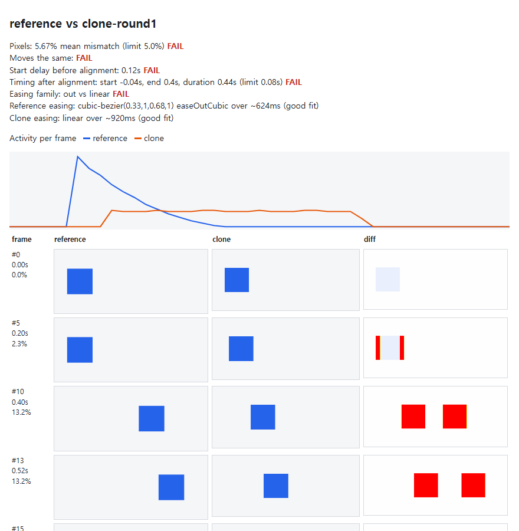
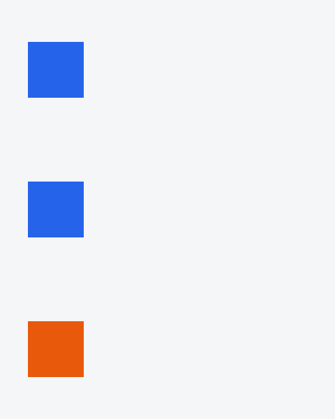
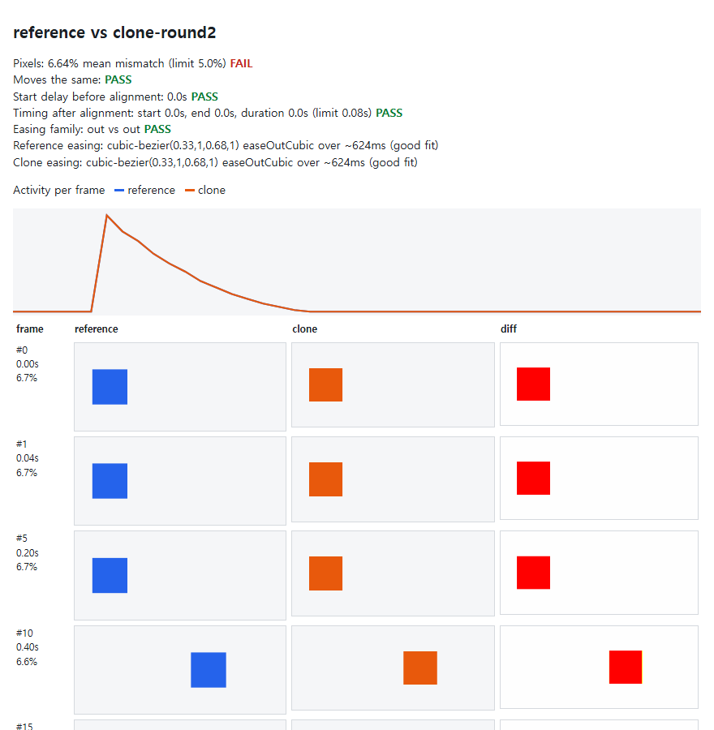

<div align="center">

# motionproof

**Prove an animation copy moves like the original: timing, easing and pixels from two recordings, just Python and ffmpeg.**

The verify step of [reanimate](https://github.com/NiazMorshed2007/reanimate), rebuilt as one Python file, so your coding agent can stop guessing whether its copy "looks right".

Works with **Claude Code** and **Codex**.

  



</div>

## Quick start

```bash
git clone https://github.com/Dodai0419/motionproof && cd motionproof
python motionproof.py --demo
```

The demo builds a reference clip and two attempts at copying it, then grades both:

```text
Round 1: a first attempt, linear easing, 120 ms late, 300 ms too long
- start delay before alignment (clone - ref): 0.12s -> FAIL
- timing error after alignment (clone - ref): start -0.04s, end 0.4s, duration 0.44s, peak -0.04s -> FAIL (limit 0.08s)
- easing: reference cubic-bezier(0.33,1,0.68,1) easeOutCubic over ~624ms (good fit); clone linear over ~920ms (good fit); family out vs linear -> FAIL
- moves the same: FAIL

Round 2: same easing and timing, own colour
- start delay before alignment (clone - ref): 0.0s -> PASS
- timing error after alignment (clone - ref): start 0.0s, end 0.0s, duration 0.0s, peak 0.0s -> PASS (limit 0.08s)
- easing: reference cubic-bezier(0.33,1,0.68,1) easeOutCubic over ~624ms (good fit); clone cubic-bezier(0.33,1,0.68,1) easeOutCubic over ~624ms (good fit); family out vs out -> PASS
- moves the same: PASS
```

On your own clips:

```bash
python motionproof.py compare original.mp4 my-copy.mp4 --out proof --width 480
```

Open `proof/report.html`, or hand `proof/report.json` to your agent.

## Install in Claude Code / Codex

```bash
/plugin marketplace add Dodai0419/motionproof
/plugin install motionproof@motionproof
```

```bash
git clone https://github.com/Dodai0419/motionproof && cp -r motionproof/skills/* ~/.codex/skills/
```

Then ask: *"Copy the card entrance in `reference.mp4` into `Hero.tsx`, film it, and keep fixing it until motionproof passes."*

## The problem

- Ask an agent to rebuild an animation and it makes one pass, calls it done, and misses. It cannot see motion, so it cannot tell how far off it is.
- The tool that solves this, reanimate, is excellent and also heavy: Bun, Playwright, a downloaded Chromium and a static ffmpeg, about 250 MB on first run, and its README says Windows is untested.
- Often you already have the two recordings. You only need the grader.

## The solution

| Idea | Fixes |
|------|-------|
| **Two recordings in, one verdict out** | Works on mp4, mov, webm, gif or a folder of PNG frames. No browser in the loop. |
| **Timing measured from the frames** | An activity curve gives start, end, duration and peak error in seconds, whatever the colours or copy. |
| **Easing named from plain video** | The centroid of what changed becomes a progress curve, fitted against 25 named easings. No DOM or element tracking needed. |
| **Pixelmatch rules, ported** | OKLab HyAB colour distance and anti-aliasing detection, so a 1 px soft edge is not called a difference. |
| **One file, standard library** | `motionproof.py` plus an ffmpeg you probably already have. |

## What you get

`compare` writes a folder:

```text
proof/
  report.html   self-contained: verdicts, activity curves, reference / clone / diff frames
  report.md     the same numbers plus an activity bar per frame, for an agent to read
  report.json   every number, per frame
  diff/         diff PNGs for the worst frames and an even sample (red differs, yellow is anti-aliasing)
```

## Gallery

These are real outputs of `python motionproof.py --demo`.

### The three clips, top to bottom: reference, round 1, round 2



Round 1 arrives late and moves evenly. Round 2 has another colour and moves exactly with the reference.

### Round 2 report: motion passes, pixels do not, as they should



This is the point of keeping the verdicts apart. Pixels fail because the copy has its own colour, and start, timing and easing all match. If you only want the motion, read `pass.motion`. If you want a pixel-exact copy, read `pass.motion` and `pass.pixels`, with `--threshold 0.02`.

## Examples

### Grade a copy

```bash
python motionproof.py compare reference.mp4 copy.mp4 --out proof --fps 25
```

```text
- frames compared: 41/45 at 25 fps, clone offset 4
- mean mismatch: **5.67%** (threshold 5.0%) -> FAIL
- motion window: reference frames 6-17 (0.48s, peak #6); clone 5-27 (0.92s, peak #5)
- start delay before alignment (clone - ref): 0.12s -> FAIL
- timing error after alignment (clone - ref): start -0.04s, end 0.4s, duration 0.44s, peak -0.04s -> FAIL (limit 0.08s)
- easing: reference cubic-bezier(0.33,1,0.68,1) easeOutCubic over ~624ms (good fit); clone linear over ~920ms (good fit); family out vs linear -> FAIL
- moves the same: FAIL
- worst frames: #13 (13.2% @ 0.52s), #20 (13.2% @ 0.8s), #8 (13.2% @ 0.32s), #9 (13.2% @ 0.36s), #10 (13.2% @ 0.4s)
```

### Name the easing in a clip

```bash
python motionproof.py ease --video reference.mp4
```

```json
{
  "samples": 45,
  "delayMs": 200,
  "visibleDurationMs": 480,
  "overshootPct": 0,
  "verdict": "cubic-bezier(0.33,1,0.68,1) easeOutCubic over ~624ms (good fit)"
}
```

That clip was really made with `easeOutCubic` over 600 ms and a 200 ms delay, then encoded to lossy H.264.

### Name the easing of numbers you already have

```bash
python motionproof.py ease --series "[[0,0],[100,30],[200,60],[300,80],[400,92],[500,98],[600,100],[700,100]]"
```

```text
"verdict": "cubic-bezier(0.2,0,0,1) material emphasized over ~750ms (good fit)"
```

### Only look at part of the frame

```bash
python motionproof.py compare ref.mp4 copy.mp4 --out proof --region 100,80,400,300
```

### Particles and grain

Noise placed differently but with the same density should not count. Blur both clips first. The sharp number is reported next to it:

```bash
python motionproof.py compare ref.mp4 copy.mp4 --out proof --blur 6
```

### A long or large clip

Pure Python counts each changed pixel, so scale down and clip:

```bash
python motionproof.py compare ref.mp4 copy.mp4 --out proof --width 480 --start 3 --end 5
```

## Getting the recordings

motionproof does not film anything. Use whatever you have:

```bash
# Windows: record a screen area for 3 seconds
ffmpeg -f gdigrab -framerate 25 -offset_x 100 -offset_y 100 -video_size 800x600 -i desktop -t 3 clip.mp4
```

```bash
# macOS: record screen 1 for 3 seconds
ffmpeg -f avfoundation -framerate 25 -i "1" -t 3 clip.mp4
```

```bash
# Linux on X11
ffmpeg -f x11grab -framerate 25 -video_size 800x600 -i :0.0+100,100 -t 3 clip.mp4
```

Playwright's `recordVideo`, a phone screen recording, a Lottie preview export and a designer's mp4 all work too. Film both clips at the same size and frame rate, or the numbers measure your setup. A different clone size is rescaled to the reference size with a warning.

## How to read failures

| Symptom | Usual cause | Fix |
|---|---|---|
| Large offset, same shape | The copy starts late or early | Fix the delay. Do not let alignment hide it |
| Clone shorter and front-loaded | Easing too aggressive | Use the fitted `durationMs` as the declared duration |
| Even activity in the clone, spiky in the reference | Linear or ease-in-out where the reference eases out | Change the easing family |
| Mismatch high at rest | Layout, font or crop difference | Fix the crop, or read timing only |
| Reference overshoots, clone does not | Spring against bezier | Use a spring or a back easing |

This table is adapted from reanimate's `references/verify.md`.

## Pass criteria

| Level | Limits |
|---|---|
| **Moves the same**: `pass.motion` | `pass.start`, `pass.timing` and `pass.easing` all hold |
| **Looks the same** | also `pass.pixels` with `--threshold 0.02`, for at most 2% mean pixel mismatch |

| Field | What it checks |
|---|---|
| `pass.start` | The first moving frame, before alignment, is within 0.08 s of the reference. A late copy fails here. |
| `pass.timing` | Start, end and duration within 0.08 s **after the clone is aligned**, as in reanimate's `compare.ts`. It does not see a late start or a wrong easing on its own. |
| `pass.easing` | Same best-fit family: out, in, in-out, linear or spring. This is the family rule from reanimate's `verify.md`. Its second rule, RMSE on element tracks, needs tracks and is not done here. |
| `pass.pixels` | Mean pixel mismatch within `--threshold`, default 5%. |

The exit code stays 0, as in reanimate: read the report.

## Why this instead of reanimate

| | [reanimate](https://github.com/NiazMorshed2007/reanimate) | motionproof |
|---|---|---|
| Timing, easing and pixel comparison | yes | yes |
| Input to compare | PNG frame folders, after extraction | video, gif or PNG folder directly |
| Names the easing from plain video | no, it reads recorded element tracks | yes |
| Films a live site for you | **yes** | **no** |
| Hover, scroll and pointer scripts | **yes** | **no** |
| Element tracks, CSS and WAAPI inventory | **yes** | **no** |
| WebGL and canvas channel comparison | **yes** | **no** |
| Guides the rebuild itself, spec and rounds | **yes** | **no**, bring your own agent loop |
| Runtime | Bun, Playwright, Chromium, ffmpeg-static | Python 3.9+ and ffmpeg |
| Windows | "untested" per its README | tests run on Windows 11 |

If you want the whole rebuild workflow from a URL, use reanimate. It is the better tool for that. Use motionproof when you have the two clips and want a verdict.

## Benchmarks

| | reanimate (compare path) | motionproof |
|---|---|---|
| Lines of code, comparison | 585 (`compare`, `easing`, `frames`, `sheet`, `lib`) plus pixelmatch and pngjs | 511 total, one file |
| Packages installed | 24 (`bun install`, measured) | 0 |
| First-run download | about 250 MB (its README) | 0, if ffmpeg is present |
| Demo: 2 comparisons, 45 frames, 480x200 | not measured | 33-39 s (2 runs) |
| Unit tests | not measured | 26 tests, 87-172 s (2 runs, the same run also rebuilt other clips) |

Machine: Windows 11, Python 3.11, ffmpeg 9.0, Commands: `python motionproof.py --demo` and `python -m unittest discover -s tests`.

reanimate itself was not run for this table, so there is no speed claim against it. It is likely faster per pixel, because motionproof is plain Python with row caching. Line and package counts come from its source and a script-free `bun install`.

## Limits

- Pure Python. A busy 1080p clip is slow, so pass `--width 480`.
- Alpha is dropped, so flatten transparent PNGs first.
- Easing from video assumes one main moving subject. Use `--region` when several things move.
- Diff PNGs cover the worst frames and an even sample, not every frame.
- `--blur` uses ffmpeg's `boxblur`, so its numbers are close to reanimate's blur, not equal.
- A dithered GIF is not usable: dithering changes about a quarter of the bytes in every frame, so the clip looks permanently in motion. ffmpeg's default GIF gave a false FAIL at 17.68% mismatch and took 4 min 7 s for 45 frames at 480x200. Make the GIF with `paletteuse=dither=none`, or compare the source video.
- `pass.easing` compares the best-fit name's family. On a slow, shallow or very short motion two close curves can land in different families, so read `bestFits` before you trust a narrow miss.

## Inspired by

- [NiazMorshed2007/reanimate](https://github.com/NiazMorshed2007/reanimate) (MIT): the comparison method, timing rules, easing table and pass criteria.
- [mapbox/pixelmatch](https://github.com/mapbox/pixelmatch) (ISC): the colour distance and anti-aliasing rules, ported for opaque pixels.

## Roadmap

- [ ] Stagger detection: several motion windows inside one clip
- [ ] A `--json` only mode for agent loops
- [ ] Optional numpy path for large frames

## License

MIT. See [LICENSE](LICENSE), which keeps the notices of reanimate and pixelmatch.
